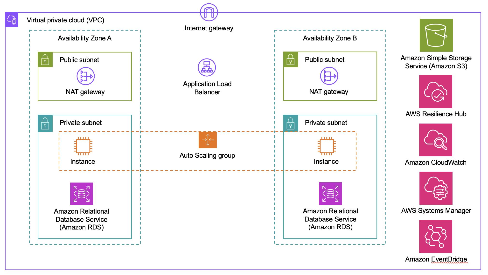

# AWS Three-Tier Cloud Application using Terraform

A beginner-friendly, hands-on AWS portfolio project that provisions a highly available web tier across two Availability Zones, a private PostgreSQL database, secure networking, monitoring, and a CI workflow.

> **Important:** This is a learning/demo environment, not a production-ready reference architecture. It uses HTTP for the demo ALB endpoint, one NAT Gateway to reduce NAT costs, a single-AZ RDS instance, and a Terraform-managed database secret. Review the security and cost notes before deployment.

## 1. Project overview

A browser sends HTTP traffic to an internet-facing Application Load Balancer (ALB). The ALB forwards requests to two Amazon EC2 application instances in private subnets. The Flask application reads database credentials from AWS Secrets Manager using an EC2 IAM role and stores a page-visit counter in a private Amazon RDS for PostgreSQL database.

Terraform creates the AWS infrastructure. GitHub Actions runs Python unit tests when code is pushed or a pull request targets `main`.

## 2. Architecture



### Request flow

1. A user opens the ALB URL.
2. The ALB listener on TCP port 80 forwards traffic to healthy EC2 targets on port 8080.
3. The Flask application retrieves the database secret using its IAM instance role.
4. The application connects to PostgreSQL on port 5432 and increments a visit counter.
5. CloudWatch receives application host logs and the ALB unhealthy-host alarm monitors target health.

### AWS services and core concepts

| Service / concept | What it does in this project |
|---|---|
| Region | Geographic AWS area where resources are created |
| Availability Zones | Separate locations within a Region; app instances span two AZs |
| VPC | Isolated virtual network (`10.20.0.0/16`) |
| Public subnet | Hosts the ALB and NAT Gateway |
| Private subnet | Hosts EC2 app instances; no public IPs |
| Route table | Directs public traffic to the Internet Gateway and private outbound traffic through NAT |
| Internet Gateway | Enables internet connectivity for public subnet resources |
| NAT Gateway | Allows private instances to initiate outbound internet connections without accepting unsolicited inbound internet connections |
| EC2 | Virtual machines that run the Flask application |
| Auto Scaling Group | Maintains two application instances |
| Application Load Balancer | Distributes HTTP requests and checks target health |
| Security groups | Stateful virtual firewalls; each tier only accepts required traffic |
| IAM role | Gives EC2 permission to read one Secrets Manager secret without storing AWS access keys on the instance |
| Secrets Manager | Stores the database connection details |
| RDS PostgreSQL | Managed relational database in private database subnets |
| S3 | Private bucket reserved for project artifacts |
| CloudWatch | Log group and alarm for unhealthy ALB targets |
| Terraform | Declarative Infrastructure as Code |
| GitHub Actions | Runs automated Python tests |

## 3. Repository structure

```text
aws-three-tier-cloud-project/
├── README.md
├── .gitignore
├── app/
│   ├── app.py
│   ├── requirements.txt
│   ├── test_app.py
│   ├── Dockerfile
│   └── templates/
│       ├── index.html
│       └── error.html
├── terraform/
│   ├── versions.tf
│   ├── provider.tf
│   ├── variables.tf
│   ├── main.tf
│   ├── outputs.tf
│   ├── user_data.sh.tftpl
│   ├── terraform.tfvars.example
│   └── .gitignore
├── architecture/
│   └── architecture-diagram.png
└── .github/
    └── workflows/
        └── ci.yml
```

## 4. Prerequisites

- An AWS account with permission to create VPC, EC2, IAM, ELB, RDS, S3, Secrets Manager, CloudWatch, Auto Scaling and related resources.
- AWS CLI v2 configured with a named profile or environment credentials.
- Terraform 1.6 or later.
- Git.
- Python 3.12 for local tests.
- A GitHub account.

Use an IAM identity with only the permissions needed for this lab. Do not use root account access keys. Never commit credentials, state files, or real `.tfvars` files.

## 5. Run the application tests locally

From the repository root:

```bash
cd app
python -m venv .venv
```

Activate the virtual environment:

**Windows PowerShell**
```powershell
.venv\Scripts\Activate.ps1
```

**macOS / Linux**
```bash
source .venv/bin/activate
```

Install dependencies and run tests:

```bash
pip install -r requirements.txt
python -m unittest -v
```

The tests check the health endpoint and the page response using a mocked database counter. They do not require an AWS account or a running PostgreSQL database.

## 6. Deploy to AWS with Terraform

Return to the repository root, then:

```bash
cd ../terraform
aws sts get-caller-identity
aws configure
```

If your AWS CLI is already configured, `aws sts get-caller-identity` should show the identity Terraform will use. Do not paste access keys into Terraform files.

Create your local variable file:

**macOS / Linux**
```bash
cp terraform.tfvars.example terraform.tfvars
```

**Windows PowerShell**
```powershell
Copy-Item terraform.tfvars.example terraform.tfvars
```

Edit `terraform.tfvars` if required. Set `allowed_http_cidr` to your public IP with `/32` where practical. The default `0.0.0.0/0` makes the demo website publicly reachable.

Initialize and validate:

```bash
terraform init
terraform fmt -recursive
terraform validate
terraform plan
```

Read the plan carefully. It creates billable resources, including a NAT Gateway, RDS instance, ALB, EC2 instances, and an Elastic IP. If the plan looks correct:

```bash
terraform apply
```

Type `yes` only after reviewing the resources and region.

Get the application URL:

```bash
terraform output application_url
```

Open the URL in a browser. Wait several minutes after apply for EC2 bootstrap, database readiness, and ALB health checks. Refresh the page: the visit counter should increase. You can also test:

```bash
curl "$(terraform output -raw application_url)/health"
curl "$(terraform output -raw application_url)/ready"
```

`/health` checks that the web process responds. `/ready` checks database connectivity.

## 7. How the Terraform configuration works

- `versions.tf`: pins Terraform and provider version constraints.
- `provider.tf`: configures the AWS provider and default tags.
- `variables.tf`: declares configurable values.
- `main.tf`: defines the VPC, subnets, gateways, security groups, ALB, EC2 Auto Scaling Group, IAM, RDS, S3, Secrets Manager and CloudWatch resources.
- `user_data.sh.tftpl`: bootstraps each EC2 instance and starts the Flask application.
- `outputs.tf`: displays useful values after deployment.

Terraform workflow:

```text
Write .tf files
     |
terraform init
     |
terraform fmt / validate
     |
terraform plan
     |
terraform apply
     |
AWS resources created
     |
terraform destroy
```

Terraform state tracks the real infrastructure and may contain sensitive values. The local state file is ignored by Git, but it is not encrypted automatically. For team or long-lived use, configure a protected S3 remote backend with encryption, versioning, restricted IAM access, and a locking strategy supported by your Terraform version. Do not upload state to GitHub.

## 8. Security design

- Only the ALB security group accepts inbound HTTP from the configured client CIDR.
- EC2 instances have no public IP and accept port 8080 only from the ALB security group.
- RDS is not publicly accessible and accepts PostgreSQL only from the app security group.
- EC2 gets a narrowly scoped IAM role that can read only this project's database secret.
- IMDSv2 is required on EC2.
- S3 public access is blocked.
- RDS storage is encrypted at rest.
- No SSH ingress rule or long-lived AWS access key is configured.

### Important hardening before production

- Add HTTPS using ACM and an HTTPS ALB listener; redirect HTTP to HTTPS.
- Restrict public ALB ingress to the intended client ranges if the application is not public.
- Use a remote encrypted Terraform state backend and separate deployment roles.
- Avoid exposing secrets in user data or Terraform state. This demo's generated DB password is represented in Terraform state; protect the state accordingly. For stronger secret lifecycle management, create/manage the secret outside this stack or use a design that avoids secret values in Terraform state.
- Enable RDS Multi-AZ, stronger backup retention, deletion protection, and a final snapshot for production.
- Add WAF, patch management, vulnerability scanning, and more detailed CloudWatch metrics/logging.
- Review IAM policies and apply least privilege.
- This example uses one NAT Gateway for cost reduction. It is a single-AZ egress dependency, not a fully resilient production NAT design.

## 9. Testing checklist

- [ ] `terraform fmt -check -recursive` passes.
- [ ] `terraform validate` passes.
- [ ] Python unit tests pass.
- [ ] Terraform plan shows only expected resources.
- [ ] ALB URL opens after target health checks pass.
- [ ] `/health` returns HTTP 200.
- [ ] `/ready` returns HTTP 200 after database connectivity is ready.
- [ ] Refreshing `/` increments the PostgreSQL visit count.
- [ ] RDS is not publicly accessible.
- [ ] EC2 instances have no public IP addresses.
- [ ] EC2 security group allows app traffic only from the ALB security group.
- [ ] GitHub Actions test workflow succeeds after pushing to `main`.

## 10. GitHub Actions CI

The workflow at `.github/workflows/ci.yml` runs on pushes and pull requests targeting `main`. It checks out the repository, sets up Python 3.12, installs app dependencies, and runs the unit tests.

To use it:

1. Create a GitHub repository named `aws-three-tier-cloud-project`.
2. Push this project to the repository's `main` branch.
3. Open the **Actions** tab.
4. Open the **Python application CI** workflow.
5. Confirm the test job passes.
6. Make a small change and push again to see the workflow run.

This workflow tests application code. It does not automatically deploy infrastructure or application releases.

## 11. Cleanup — avoid ongoing AWS charges

When you finish testing, destroy the infrastructure:

```bash
cd terraform
terraform destroy
```

Review the plan and type `yes` to confirm. Then check the AWS Console in the selected region for leftover resources, especially:
- NAT Gateway and Elastic IP
- Load balancer
- EC2 instances and Auto Scaling Group
- RDS database
- Secrets Manager secret
- S3 bucket and any uploaded objects
- CloudWatch log group

The Terraform S3 bucket is configured for force deletion, but if you change that setting or add other buckets, empty them before deletion. Confirm the resources are gone before leaving the account.

## 12. Common troubleshooting

**ALB returns 503**
- Wait for EC2 bootstrap to finish.
- Check target group health in EC2 > Load Balancers > Target Groups.
- Check the instance system log and CloudWatch log group.
- Confirm the app process is listening on port 8080.

**`/health` works but `/ready` fails**
- Check RDS status and endpoint.
- Check that the RDS security group allows port 5432 from the app security group.
- Check the Secrets Manager secret and EC2 IAM role permissions.
- Check application logs.

**Terraform cannot find credentials**
- Run `aws sts get-caller-identity`.
- Configure AWS CLI credentials or select the intended profile.
- Do not put access keys in `.tf` files.

**Availability Zone or instance class error**
- Confirm the chosen instance class and engine version are supported in your selected region.
- Change `aws_region` or the instance class if necessary.

## 13. Interview questions and answers

**1. What is a VPC?**  
A Virtual Private Cloud is a logically isolated network in AWS where I define IP ranges, subnets, routes, and network security.

**2. What is the difference between a public and private subnet?**  
A public subnet has a route to an Internet Gateway. A private subnet does not have direct inbound internet routing. In this project, the ALB is public and EC2/RDS are private.

**3. What does an Internet Gateway do?**  
It enables internet connectivity for resources in a VPC when their subnet route table and security rules allow it.

**4. What is a NAT Gateway?**  
It allows resources in private subnets to initiate outbound internet connections without being directly reachable through unsolicited inbound internet traffic.

**5. Why use two Availability Zones?**  
To distribute application instances across separate Availability Zones and reduce the impact of an AZ-level failure.

**6. What is an Application Load Balancer?**  
It distributes HTTP/HTTPS requests to registered targets and uses health checks to identify healthy targets.

**7. What is an Auto Scaling Group?**  
It maintains a desired number of EC2 instances and can replace unhealthy instances.

**8. What is a security group?**  
A stateful virtual firewall attached to resources such as EC2, ALB, and RDS network interfaces.

**9. What is IAM?**  
Identity and Access Management controls who can access AWS resources and which actions they can perform.

**10. Why use an IAM role on EC2?**  
It provides temporary credentials to the instance so the application can call AWS services without embedding access keys.

**11. Why is RDS in private subnets?**  
The database should not accept direct public internet connections. Only the application tier should be allowed to connect.

**12. What is Secrets Manager?**  
A managed service for storing and retrieving secrets such as database credentials.

**13. What is Terraform?**  
An Infrastructure as Code tool that describes infrastructure declaratively and manages its lifecycle through plan and apply operations.

**14. What is Terraform state?**  
A mapping between Terraform configuration and real infrastructure. It can contain sensitive information and must be protected.

**15. What is the difference between `terraform plan` and `terraform apply`?**  
`plan` previews proposed changes; `apply` executes them.

**16. What is CloudWatch?**  
AWS monitoring and observability service for metrics, logs, alarms, and operational visibility.

**17. What is CI/CD?**  
Continuous Integration automatically builds and tests changes. Continuous Delivery or Deployment automates the process of preparing or releasing software.

**18. How does a request reach the database in this project?**  
The browser sends a request to the ALB, which forwards it to a private EC2 Flask instance. The app retrieves its DB secret using IAM and connects to private RDS PostgreSQL.

**19. Is this production-ready?**  
No. It is a learning project. Production would require HTTPS, resilient NAT, Multi-AZ RDS, protected remote Terraform state, stronger secret lifecycle controls, and additional monitoring and security controls.

**20. How would you troubleshoot an application outage?**  
I would check ALB target health, EC2 instance status, application logs, security group rules, Secrets Manager access, RDS status, and database connectivity.

## 14. Resume / portfolio description

**Project title:** AWS Three-Tier Cloud Infrastructure Deployment using Terraform

**Description:** Designed and provisioned a three-tier AWS cloud environment using Terraform, including VPC networking, public and private subnets, Application Load Balancer, EC2 Auto Scaling, private RDS PostgreSQL, IAM roles, Secrets Manager, S3, and CloudWatch. Built a Python Flask application and automated unit testing with GitHub Actions.

Only describe this as a hands-on portfolio project. Do not present it as production experience unless you have actually operated it in production.

## 15. Suggested GitHub repository description

Provisioned a three-tier AWS cloud architecture using Terraform, featuring VPC networking, EC2 Auto Scaling, Application Load Balancer, private RDS PostgreSQL, IAM, Secrets Manager, S3, CloudWatch, and GitHub Actions CI.
